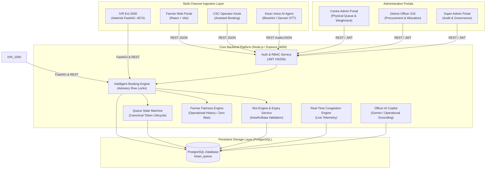

# Kisan Vikas — Technical Design Document & System Architecture

## 1. Executive Overview

**Kisan Vikas** is an end-to-end Agricultural Procurement Scheduling and Real-Time Queue Orchestration System engineered to eliminate chaotic physical queues, distress selling, and opaque middleman intervention at government Direct Purchase Centres (DPCs).

The platform bridges digital smartphone farmers, feature-phone farmers (via telephone IVR), Common Service Centre (CSC) operators, Centre Administrators, and District Officers through a single source of truth powered by PostgreSQL.

---

## 2. High-Level System Architecture



---

## 3. Core Architectural Subsystems

### 3.1 Date & Time Architecture (Calendar Date vs Timestamp)
A procurement appointment date is defined strictly as a **calendar date** (`YYYY-MM-DD` in `Asia/Kolkata`), completely decoupled from UTC offset transformations:
- **Calendar Date**: `2026-10-08` stored as PostgreSQL `DATE`. Driver returns raw `YYYY-MM-DD` string (OID 1082 type parser), completely bypassing JavaScript Date UTC conversion.
- **Slot Start / End**: Expressed in 24-hour local format (`08:00:00` to `09:00:00`).
- **Slot Expiration**: Evaluated dynamically using `(NOW() AT TIME ZONE 'Asia/Kolkata')`. Slots whose end times have passed automatically transition to expired, and un-arrived bookings transition to `Expired` / `Missed Visit`.

### 3.2 Canonical Booking Lifecycle
```
[Booked] ──> [Confirmed] ──> [On The Way]
                                   │
                                   ▼
                             [Checked-In]  <── (Farmer physically arrives)
                                   │
                                   ▼
                              [Grading]   <── (Quality inspection / FAQ standards)
                                   │
                                   ▼
                              [Weighing]  <── (Gross & tare weighment)
                                   │
                                   ▼
                              [Procured]  <── (Stock accepted into warehouse)
                                   │
                                   ▼
                          [Payment Pending]
                                   │
                                   ▼
                         [Payment Completed] <── (DBT transfer completed / Historical)
```
- **Active Appointments**: Only uncompleted visits for future or active today slots appear in "Your Active Visit".
- **Physical Queue Exclusion**: Once marked `Payment Completed`, `Cancelled`, or `Expired`, visits are strictly excluded from the physical queue.

### 3.3 Concurrency & Atomic Capacity Serialization
To eliminate double-booking and slot oversubscription:
- Every booking request acquires a transactional PostgreSQL advisory lock on the farmer (`farmer_booking_<id>`) and a row-level lock (`SELECT ... FOR UPDATE`) on the target slot.
- Available capacity is verified atomically: `booked_count < max_farmers`.
- Duplicate submissions are safeguarded by UUID-based idempotency keys with automatic replay protection.

### 3.4 Operational Fairness & Priority Engine
Fairness scoring prioritizes farmers facing operational friction without socioeconomic profiling:
- **Reschedule Penalty Points**: +15 points per system reschedule.
- **Disruption Recovery Points**: +25 points for centre operational downtime.
- **Recency Boost**: +30 points for incidents in the past 24 hours.
- **Socioeconomic Neutrality**: Zero landholding, demographic, or financial attributes are permitted in scoring.

### 3.5 Authoritative IVR Telephony (Extension 2000)
- **Extension 2000** (Port 4574): Authoritative FastAGI telephony supporting trilingual voice prompts (Tamil, English, Hindi), caller identification, one-touch automatic allocation, distance-optimized nearest centre selection, and automated DBT status playback.
- **MicroSIP Integration**: Full SIP client compatibility on port 5060 connecting to local Asterisk PBX. Direct caller phone simulation supported via `2000*<PHONE>` dialing pattern.

---

## 4. Security & Role-Based Access Control (RBAC)

| Role | Access Scope | Enforced Guards |
| :--- | :--- | :--- |
| `FARMER` | Personal bookings, profile, digital pass, grievances | Scoped strictly to authenticated `farmerId` |
| `CENTRE_ADMIN` | Queue management, weighment, grading, centre capacity | Scoped strictly to assigned `centreId` |
| `DISTRICT_OFFICER` | District centres, demand forecasting, reallocation | Scoped strictly to assigned `district` |
| `CSC_OPERATOR` | Assisted farmer registration and booking | Scoped strictly to assigned CSC catchment |
| `SUPER_ADMIN` | Global governance, officer provisioning, audit logs | Platform-wide administrative authority |
