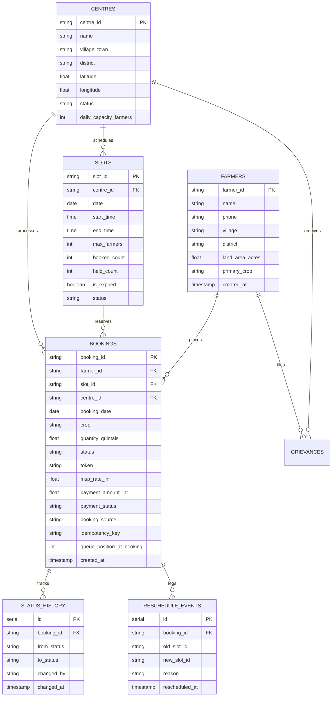

# Kisan Vikas — Database Schema & Architecture Specification

## 1. Overview
The Kisan Vikas database is hosted on **PostgreSQL** (`kisan_queue`). It serves as the single source of truth across all channels (Farmer Web, IVR Ext 1000, IVR Ext 2000, Centre Admin Portal, District Officer Dashboard, and Super Admin Portal).

---

## 2. Primary Tables & Relationships



---

## 3. Data Integrity & Concurrency Constraints

1. **Calendar Date Preservation (OID 1082)**:
   - All appointment dates (`bookings.booking_date`, `slots.date`) are defined as PostgreSQL `DATE`.
   - Node-postgres driver type parser 1082 returns raw text strings (`YYYY-MM-DD`), preventing UTC shifts during JSON serialization.

2. **Atomic Slot Row Locking**:
   - Concurrent bookings use `SELECT * FROM slots WHERE slot_id = $1 FOR UPDATE`.
   - Slots increment `booked_count` atomically:
     ```sql
     UPDATE slots SET booked_count = booked_count + 1 WHERE slot_id = $1 AND booked_count < max_farmers;
     ```

3. **Single Active Booking Invariant**:
   - A farmer is restricted to at most one active appointment across future or current calendar dates until the existing appointment reaches a terminal state (`Payment Completed`, `Cancelled`, `Expired`).

4. **District-Centre Boundary Invariant**:
   - Cross-district bookings are prohibited by database and application checks ensuring `farmers.district == centres.district`.
